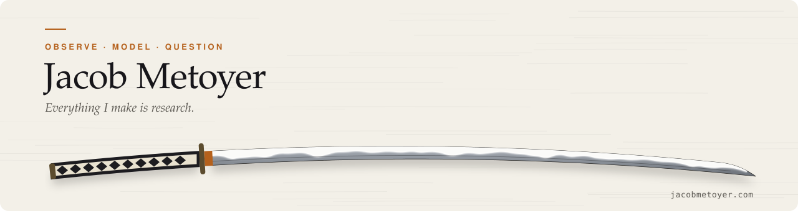

<picture>
  <source media="(prefers-color-scheme: dark)" srcset="./assets/profile-banner-dark.svg">
  <source media="(prefers-color-scheme: light)" srcset="./assets/profile-banner-light.svg">
  
</picture>

## Hi, I'm Jacob.

CS + physics at Cal State Long Beach (biology minor), BUILD Scholar working toward MD/PhD training. I direct AI agents to build research software, games and tools, and I decide what ships. Checks come before claims: runnable demos, public source where possible, and explicit limits.

### Now

- **[Hamon](https://hamon.works/)** — my studio: tools for AI, experiences for people.
- **Hamon Engine** *(private source)* — a Rust + wgpu engine built for AI agents to drive: typed ECS commands, replay and agent control. Current work is a humanoid character creator whose quality is held by numeric gates (seams, penetration, stretch, gait) rather than eyeballed renders — species bodies, tails and ears with spring physics, and strand fur.
- **[Wildside](https://jacobmetoyer.com/wildside/)** — enter the living worlds of the places around you. Playable in the browser.
- **[Lanternwake](https://jacobmetoyer.com/games/lanternwake/)** — small Hamon Engine browser game (WebGPU).

### Recent public work

| Project | What it is |
|---|---|
| [**TowerOps**](https://jacobmetoyer.com/TowerOps/airspace/) | Synthetic ATC conflict-awareness and bounded-agent research demo; not operational ATC. |
| [**CaptureSuite**](https://github.com/Jacob-Met/CaptureSuite) | Windows-first multimodal research capture: daemon, versioned worker plugins, sealed sessions, PySide6 UI. |
| [**NULLGARDEN**](https://github.com/Jacob-Met/nullgarden) | Executable negative controls for scientific ML — does that AUC survive when the signal is removed? |
| [**Experimental Earth**](https://github.com/Jacob-Met/experimental-earth) | Local workbench for investigating water, shade and terrain changes to a real place. Early. |
| [**TestPilot**](https://github.com/Jacob-Met/testpilot) | Agent that writes, runs and repairs regression tests for a diff (Nebius × NVIDIA hackathon). |
| [**household-ledger-mcp**](https://github.com/Jacob-Met/household-ledger-mcp) | Typed TypeScript MCP server for household income, expenses and budgets. |
| [**CanvasPilot**](https://github.com/Jacob-Met/canvaspilot) | MCP server + CLI for Canvas LMS that rides your existing browser session. |
| [**RecallWeave**](https://jacobmetoyer.com/RecallWeave/explore.html) | Browser-only learning toolkit with a transparent Bayesian learner; no learning-gain claim. |

**Small prototypes (Oct 2026):** [forkscope](https://github.com/Jacob-Met/forkscope) · [worldlaw](https://github.com/Jacob-Met/worldlaw) · [equivia](https://github.com/Jacob-Met/equivia) · [masks](https://github.com/Jacob-Met/masks) · [shadow-stage](https://github.com/Jacob-Met/shadow-stage) · [common-test](https://github.com/Jacob-Met/common-test) · [crosswire](https://github.com/Jacob-Met/crosswire) · [quiet-mesh](https://github.com/Jacob-Met/quiet-mesh) · [assumption-arcade](https://github.com/Jacob-Met/assumption-arcade) · [pausepoint](https://github.com/Jacob-Met/pausepoint) · [loopkind](https://github.com/Jacob-Met/loopkind) · [ludolingua](https://github.com/Jacob-Met/ludolingua)

**Also:** [workflow-checks](https://github.com/Jacob-Met/workflow-checks) · [multi-agent-fanout-engine](https://github.com/Jacob-Met/multi-agent-fanout-engine) · [uma-sim](https://github.com/Jacob-Met/uma-sim) · [Spire of Octaves](https://spireofoctaves.com/) (my fiction world)

### Research

Gait and rehabilitation, behavioral neurobiology, protein molecular dynamics, and collaborative surgical-ergonomics work. Research contributions are collaborative; synthetic demos are not evidence of clinical validity or savings on someone else's data.

**[jacobmetoyer.com](https://jacobmetoyer.com/)** · [hamon.works](https://hamon.works/) · [LinkedIn](https://www.linkedin.com/in/jacob-metoyer-15b701352)
